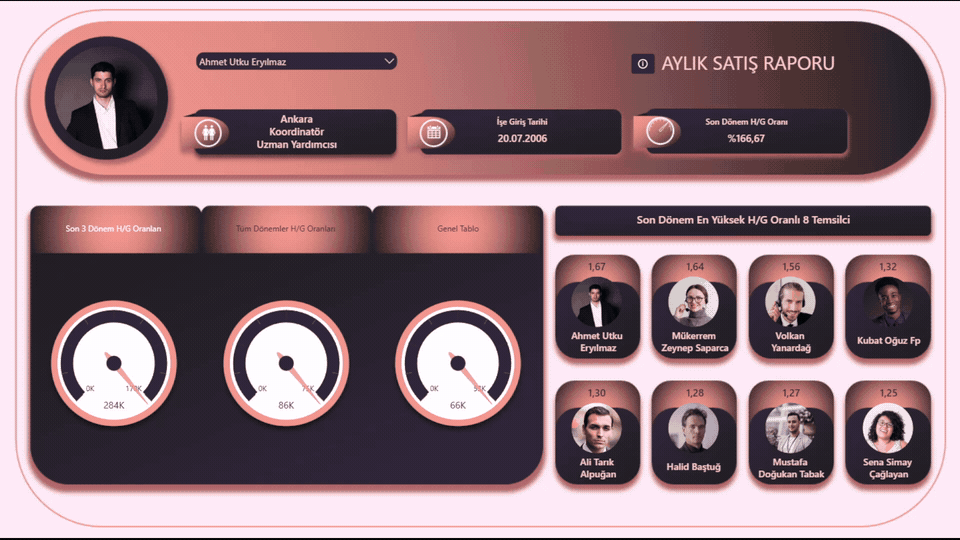
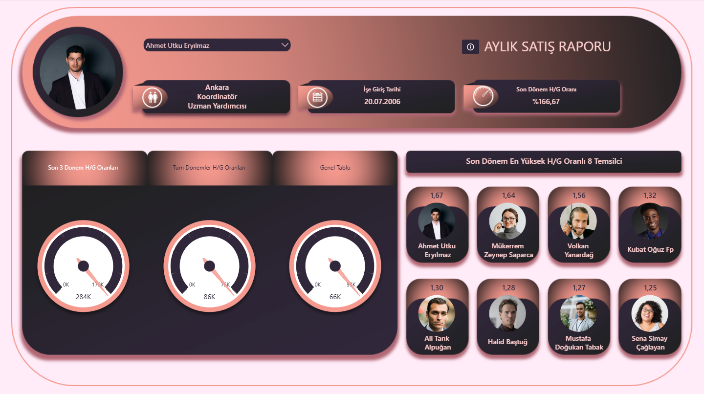

# Employee Sales Performance Dashboard

An interactive Power BI dashboard designed to analyze employee sales performance, track sales targets, and compare individual achievements using sales data from January 2022 to July 2022.

> **Note:** This is a guided course project created while learning and practicing Power BI. The project was used to apply concepts such as DAX measures, interactive filtering, employee performance analysis, dynamic visualizations, and dashboard design.

## Dashboard Demo

## Project Overview

The dashboard analyzes employee sales performance over a seven-month period, from January 2022 to July 2022.

It provides detailed information about individual employees, including their region, job title, employment start date, and latest-period sales target achievement rate.

The report also highlights the eight highest-performing employees based on their latest-period target achievement rates.

## Dashboard Overview

Provides an interactive overview of employee sales performance, including target achievement rates, historical sales trends, employee rankings, and detailed sales comparisons.

The dashboard features a custom background designed in Microsoft PowerPoint.

## Interactive Features

- Employee selection using a slicer
- Dynamic employee profiles displaying photos, regions, job titles, and employment start dates
- Latest-period sales target achievement rate for the selected employee
- Fixed Top 8 employee ranking based on latest-period target achievement rates, unaffected by report interactions
- Three interactive analysis tabs:
  - **Recent Performance:** Three dial gauges displaying the selected employee's sales target achievement rates for the latest three months
  - **Historical Performance:** Area chart displaying the selected employee's target achievement rates across all available months
  - **Employee Comparison:** Detailed employee performance table and a horizontal bar chart ranking employees by total sales
- Interactive filtering between the employee ranking bar chart and the detailed performance table

## Tools & Technologies

- Power BI Desktop
- DAX
- Microsoft PowerPoint (Dashboard Background Design)
- Data Visualization
- Interactive Dashboard Design

## Key Metrics

The dashboard tracks:

- Total Sales
- Total Sales Target
- Sales Target Achievement Rate (%)
- Monthly Target Achievement Rates
- Latest Three-Month Performance
- Employee Sales Rankings
- Top 8 Employees by Latest-Period Target Achievement Rate

## Project File

The Power BI report file is available in this repository:

`employee_sales_dashboard.pbix`
